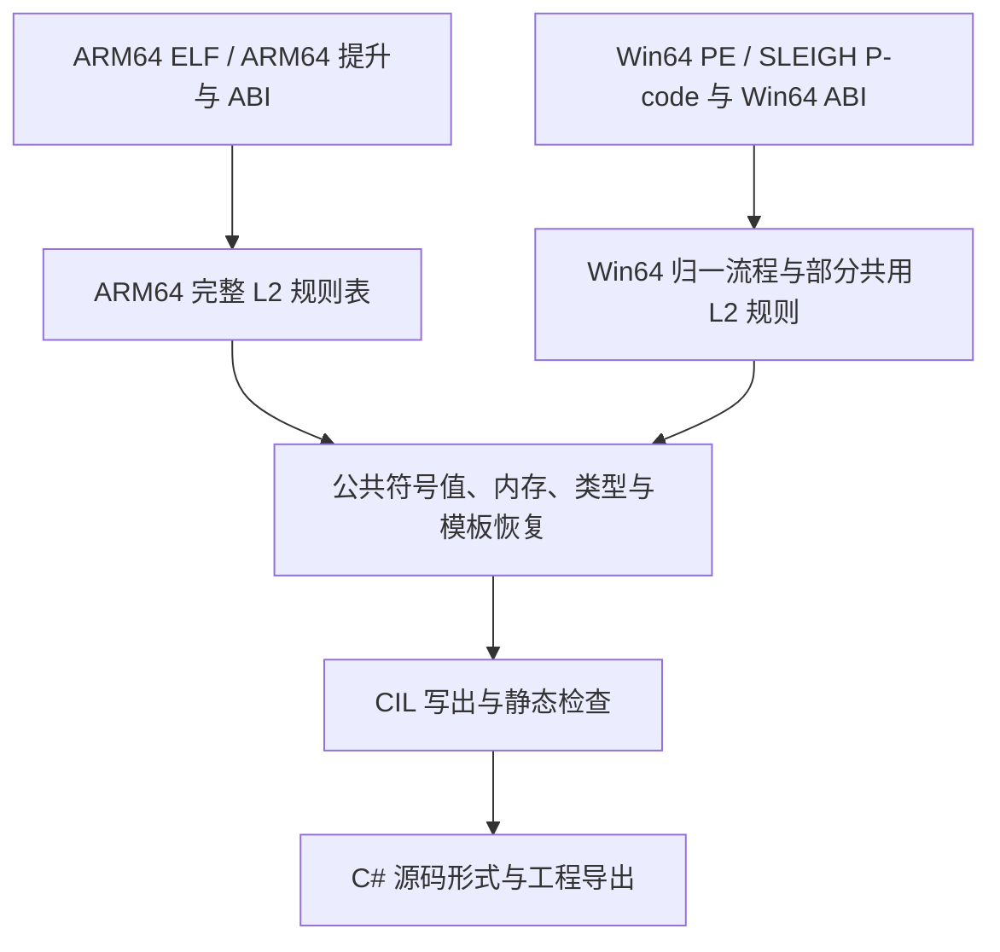

# 文档索引

本仓库保留 ARM64 恢复管线及实验性的 Windows x64 后端。Win64 适配未完成，不宣称两个后端已经达到同等级；当前不继续承诺补齐或修复时限。

| 文档 | 内容 |
|---|---|
| [Win64 后端](WIN64_BACKEND.md) | 构建、使用、模块边界和输出 |
| [已知局限](LIMITATIONS.md) | 机器语义、异常、ABI、内存、调用身份及公共输出的限制 |
| [L2 对照](L2_PARITY.md) | ARM64 规则与 Win64 实际入口、执行时序的差别 |
| [验证记录](VALIDATION.md) | 全量样本统计、剩余归因、已验证与未验证的内容 |

## 分层与归因

共用 L3 和输出组件，不代表进入这些组件的 IR 已经达到相同质量。错误最后报在内存、类型或访问权限检查中，仍可能由 Win64 上游缺少运行时契约、丢失副本关系或未完成惯用法归一引起。

完整写出、静态检查通过、源码工程可编译、执行语义等价和真实游戏可运行是不同结论。不得把其中一项当作其他项的证明。未恢复体和可读片段仍保留显式诊断，不计入完整成功。

样本二进制、元数据、逐方法业务诊断和机器配置只保存在忽略的本地目录；仓库文档只记录通用能力及匿名汇总。
